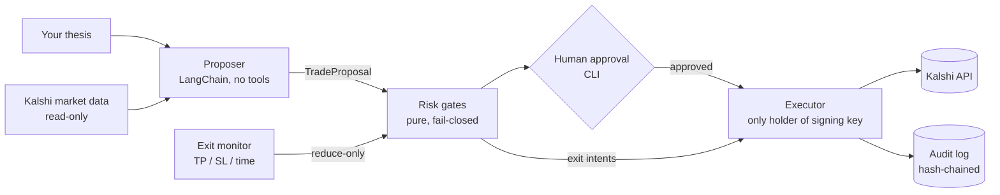

# Kalshi Uatu

An LLM-assisted, human-approved trading assistant for [Kalshi](https://kalshi.com) prediction markets.
An LLM proposes trades from your thesis, deterministic risk gates check them, **you approve every entry**, and the bot automatically exits positions when your configurable take-profit, stop-loss, or time rules fire.

> ⚠️ Trading event contracts involves risk of loss. This software is provided as-is, without warranty. It defaults to Kalshi's **demo** environment.

## Architecture



| Layer | Holds credentials | Can place orders |
|---|---|---|
| Proposer (LLM) | No | No |
| Risk gates | No | No |
| Approval | No | No |
| Exit monitor | No | No (emits intents) |
| Executor | **Yes** | **Yes** |

## Safety model

- **LLM is advisory only.** It has no tools, no credentials, and no path to the order API ([ADR-0005](docs/adr/0005-langchain-proposal-layer.md)).
- **Every entry needs your approval**, bound to the exact proposal and short-lived ([ADR-0006](docs/adr/0006-human-approval-for-entries.md)).
- **Exits are automatic but reduce-only**, so they can never add exposure ([ADR-0009](docs/adr/0009-configurable-exit-rules.md)).
- **Risk gates** (max order cost, max daily loss, max open exposure, kill switch) are individually switchable and fail closed ([ADR-0008](docs/adr/0008-configurable-risk-gates.md)).
- **Keys live in the OS keychain**, never in `.env`, env vars, or the repo ([ADR-0007](docs/adr/0007-secret-management.md)).
- **Demo by default;** production requires a config opt-in, a CLI flag, and typed confirmation ([ADR-0010](docs/adr/0010-demo-by-default.md)).

## Configuration

Copy `config/strategy.example.toml` to `config/strategy.toml` (gitignored). Gates and exit rules each have `enabled` and a threshold; CLI flags override for a single run.

```bash
uatu run --take-profit-pct 15 --no-stop-loss --max-order-cost 2500
```

## Quickstart (planned CLI)

```bash
uv sync
uatu secrets set kalshi-demo-key-id
uatu secrets set kalshi-demo-private-key --from-file ~/Downloads/kalshi-demo.key
uatu propose --thesis strategy/thesis.md   # review and approve
uatu run                                   # exit monitor
uatu kill                                  # cancel all and halt
```

## Architecture decisions

| ADR | Decision |
|---|---|
| [0001](docs/adr/0001-record-architecture-decisions.md) | Record architecture decisions |
| [0002](docs/adr/0002-public-engine-private-strategy.md) | Public engine, private strategy config |
| [0003](docs/adr/0003-python-toolchain.md) | Python 3.12, uv, ruff, mypy strict, pydantic |
| [0004](docs/adr/0004-layered-architecture.md) | Layered architecture with isolated executor |
| [0005](docs/adr/0005-langchain-proposal-layer.md) | LangChain for proposals only, provider-agnostic |
| [0006](docs/adr/0006-human-approval-for-entries.md) | Human approval for entries; automatic exits |
| [0007](docs/adr/0007-secret-management.md) | Secrets via `SecretProvider` (Keychain → AWS) |
| [0008](docs/adr/0008-configurable-risk-gates.md) | Configurable, fail-closed risk gates |
| [0009](docs/adr/0009-configurable-exit-rules.md) | Configurable TP / SL / time exits |
| [0010](docs/adr/0010-demo-by-default.md) | Demo by default; production opt-in |
| [0011](docs/adr/0011-thin-exchange-client.md) | Thin in-house Kalshi client |
| [0012](docs/adr/0012-polling-exit-monitor.md) | REST polling exit monitor (v1) |
| [0013](docs/adr/0013-audit-log-and-persistence.md) | Hash-chained SQLite audit log |
| [0014](docs/adr/0014-cli-first-interface.md) | CLI first (Typer + Rich) |
| [0015](docs/adr/0015-repository-security-controls.md) | Repo and supply-chain security |

## Status

Design phase. See ADRs; implementation follows.

## License

MIT
